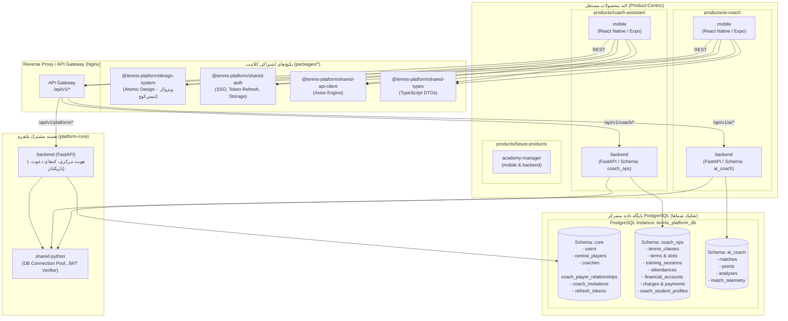

# سند معماری فنی و جامع پلتفرم چندمحصولی تنیس (Coach Assistant Platform)

> **نسخه:** 1.1.0 (ویرایش ساختار محصول‌محور - Product-Centric)  
> **وضعیت:** سند اجرایی مصوب معماری (Architecture Blueprint)  
> **مخاطب:** تیم توسعه و طراحان سیستم  
> **اصول محوری:** سادگی و کارایی، عدم اور‌مهندسی، حفظ کدهای موجود بدون تغییر مخرب، استقلال اپلیکیشن‌ها و توسعه‌پذیری بالا

---

## ۱. ارزیابی الگوهای مقاله و انتخاب معماری نهایی

در مقاله مرجع (*React Native Architecture: 8 Folder Structures for Scalable Apps*) هشت ساختار برای مدیریت کدهای فرانت‌اند مقایسه شده‌اند. تحلیل تطبیقی این الگوها بر اساس نیازمندی‌های پلتفرم چندمحصولی تنیس به شرح زیر است:

### ۱.۱. ارزیابی ۸ الگوی ساختاری مقاله
1. **Flat / Basic Structure:** تمام فایل‌ها در یک پوشه مسطح؛ صرفاً مناسب برای پروتوتایپ‌های تک‌روزه و غیرقابل استفاده برای یک پلتفرم چندمحصولی.
2. **Grouped by File Type (Technical Layering):** دسته‌بندی بر اساس نوع فایل (`screens`, `components`, `hooks`, `services`). این الگو برای تفکیک کلی مناسب است اما با رشد فیچرها موجب پراکندگی کدها می‌شود.
3. **Feature-Based Architecture (معماری مبتنی بر فیچر):** هر ماژول بیزینسی (`auth`, `classes`, `finance`, `matches`, `analysis`) پوشه مجزای خود را شامل کامپوننت‌ها، هوک‌ها، و وضعیت اختصاصی دارد. این الگو به «معماری فریادزننده» (Screaming Architecture) معروف است و خوانایی کد را به اوج می‌رساند.
4. **Domain-Based Architecture (معماری مبتنی بر دامنه - DDD):** جداسازی هسته کسب‌وکار، مدل‌های دامنه و منطق از لایه‌های نمایش و زیرساخت.
5. **Hybrid / Modular Architecture:** ترکیب ماژول‌های مجزا با هسته اشتراکی پلتفرم.
6. **Monorepo Architecture (معماری مونوریپو):** مدیریت چند اپلیکیشن و کتابخانه‌های مشترک در یک مخزن واحد با ابزاری مانند `pnpm workspaces`.
7. **Atomic Design:** تجزیه کامپوننت‌های UI به اتم‌ها، مولکول‌ها، ارگانیسم‌ها، تمپلیت‌ها و صفحات. این الگو استاندارد طلایی پیاده‌سازی `Design System` مقیاس‌پذیر است.
8. **Clean Architecture (Hexagonal / Onion):** تفکیک سختگیرانه لایه‌های انتزاعی که برای نیاز فعلی خطر Over-Engineering دارد.

### ۱.۲. معماری نهایی منتخب: Product-Centric Monorepo (معماری محصول‌محور)
پاسخ بهینه و تصویب‌شده، **قرارگیری فرانت‌اند و بک‌اند هر محصول در کنار هم** درون پوشه اختصاصی آن محصول است:

```
┌────────────────────────────────────────────────────────────────────────┐
│                   PRODUCT-CENTRIC MONOREPO (pnpm workspaces)           │
│                                                                        │
│   ┌──────────────────────────────────┐ ┌───────────────────────────┐   │
│   │ products/coach-assistant         │ │ products/ai-coach         │   │
│   │ ├── mobile/ (Feature-Based)      │ │ ├── mobile/ (Feature-Based) │ │
│   │ └── backend/ (FastAPI coach_ops) │ │ └── backend/ (FastAPI ai) │   │
│   └─────────────────┬────────────────┘ └─────────────┬─────────────┘   │
│                     │                                │                 │
│                     ▼                                ▼                 │
│         ┌──────────────────────────────────────────────────┐           │
│         │ packages/design-system (Atomic Design)           │           │
│         │ packages/shared-auth, shared-types, utils...     │           │
│         └──────────────────────────────────────────────────┘           │
│                                      ▲                                 │
│                                      │                                 │
│         ┌────────────────────────────┴─────────────────────┐           │
│         │ platform-core/                                   │           │
│         │ ├── backend/ (FastAPI core schema)               │           │
│         │ └── shared-python/ (DB Pool & JWT Verify)        │           │
│         └──────────────────────────────────────────────────┘           │
└────────────────────────────────────────────────────────────────────────┘
```

#### چرا این معماری انتخاب شد؟
1. **انطباق ۱۰۰٪ با ساختار کنونی:** کدهای موجود شما برای تنیس‌کوچ شامل `mobile/` و `backend/` و برای تنیس‌پایلوت شامل `ui/` و `backend/` است. با قرار گرفتن آنها در کنار هم، کمترین تغییر در ساختار ذهنی و گردش کار توسعه‌دهنده رخ می‌دهد.
2. **کپسوله‌سازی کامل هر محصول (Full Autonomy):** توسعه‌دهنده در حین پیاده‌سازی یک قابلیت (مانند ثبت زنده مسابقه یا حضور و غیاب)، تمام لایه‌های کلاینت و سرور همان محصول را در دسترس دارد.
3. **تفکیک تمیز Node.js و Python:** پکیج‌منیجر `pnpm` فقط مسئول پوشه‌های فرانت‌اند و پکیج‌های اشتراکی است و هیچ تداخلی با محیط‌های مجازی و نیازمندی‌های پایتون بک‌اند ایجاد نمی‌کند.
4. **جایگاه مستقل Platform Core:** سرویس‌های هویت مرکزی، کاربران و کدهای دعوت به کل پلتفرم تعلق دارند و به صورت متمرکز در `platform-core` مدیریت می‌شوند.

---

## ۲. دیاگرام کلان پلتفرم و جریان ارتباطات



---

## ۳. ساختار نهایی و کامل ریپوزیتوری Monorepo

```text
coach-assistant-platform/
│
├── products/                             # محصولات مستقل پلتفرم
│   │
│   ├── coach-assistant/                  # محصول ۱: مدیریت مربی، کلاس‌ها و امور مالی (tennis-coach)
│   │   ├── mobile/                       # اپلیکیشن React Native با Expo Router v5
│   │   │   ├── src/
│   │   │   │   ├── app/                  # روت‌های ناوبری فایل‌محور
│   │   │   │   ├── features/             # ماژول‌های Feature-based (attendance, classes, finance, students)
│   │   │   │   └── shared/               # ری‌اکسپورت از پکیج‌های دیزاین‌سیستم برای سازگاری ۱۰۰٪
│   │   │   ├── android/
│   │   │   ├── assets/
│   │   │   ├── app.json
│   │   │   ├── package.json              # نام: @tennis-platform/mobile-coach-assistant
│   │   │   └── tsconfig.json
│   │   │
│   │   ├── backend/                      # بک‌اند FastAPI عملیات کلاس، جلسات و مالی (Schema: coach_ops)
│   │   │   ├── app/
│   │   │   │   ├── api/                  # روترها و اندپوینت‌های کلاس و مالی
│   │   │   │   ├── domain/               # قوانین بیزینس تنیس و تقویم جلالی
│   │   │   │   └── infrastructure/       # مدل‌های SQLAlchemy 2.0
│   │   │   ├── migrations/               # اسکریپت‌های مایگریشن Alembic شِمای coach_ops
│   │   │   ├── requirements.txt
│   │   │   └── main.py
│   │   │
│   │   └── docs/                         # مستندات بیزینسی اختصاصی مربی (Business-Rule.md, PROJECT_GUIDE.md)
│   │
│   ├── ai-coach/                         # محصول ۲: دستیار هوش مصنوعی و ثبت مسابقات (TennisPilot)
│   │   ├── mobile/                       # اپلیکیشن React Native تنیس‌پایلوت
│   │   │   ├── src/
│   │   │   │   ├── navigation/           # سیستم ناوبری اپ
│   │   │   │   ├── screens/              # صفحات ثبت زنده، آمار و گزارش AI
│   │   │   │   ├── features/             # ماژول‌های live-scoring و ai-insights
│   │   │   │   └── utils/                # scoringEngine.ts و tennisLogic.ts
│   │   │   ├── android/
│   │   │   ├── assets/
│   │   │   ├── app.json
│   │   │   ├── package.json              # نام: @tennis-platform/mobile-ai-coach
│   │   │   └── tsconfig.json
│   │   │
│   │   ├── backend/                      # بک‌اند FastAPI مسابقات، امتیازات و تحلیل AI (Schema: ai_coach)
│   │   │   ├── app/
│   │   │   │   ├── routers/              # روترهای matches, points, analysis
│   │   │   │   ├── models/               # مدل‌های دیتابیس مسابقات متصل به player_id مرکزی
│   │   │   │   └── services/             # موتور تحلیل هوش مصنوعی (Gemini/Claude) و لاجیک تنیس
│   │   │   ├── migrations/               # اسکریپت‌های مایگریشن Alembic شِمای ai_coach
│   │   │   ├── requirements.txt
│   │   │   └── main.py
│   │   │
│   │   └── docs/                         # مستندات موتور تنیس و پرامپت‌ها
│   │
│   └── future-products/                  # دایرکتوری محصولات آینده
│       ├── academy-manager/
│       └── tournament-manager/
│
├── platform-core/                        # هسته مرکزی و مشترک پلتفرم
│   │
│   ├── backend/                          # سرویس مرکزی احراز هویت و کدهای دعوت (FastAPI / Schema: core)
│   │   ├── app/
│   │   │   ├── auth/                     # احراز هویت مرکزی، ثبت‌نام و صدور JWT
│   │   │   ├── users/                    # مدیریت اطلاعات عمومی کاربران
│   │   │   ├── players/                  # مدیریت هویت سراسری بازیکنان
│   │   │   └── invitations/              # کدهای یکتای اتصال مربی-شاگرد (TC-XXXXXX)
│   │   ├── migrations/                   # مایگریشن شِمای core
│   │   ├── requirements.txt
│   │   └── main.py
│   │
│   └── shared-python/                    # کدهای مشترک پایتون برای تمام بک‌اندها
│       ├── db/
│       │   ├── base.py                   # کلاس پایه DeclarativeBase و Mixinها
│       │   └── session.py                # کانکشن‌پول دیتابیس مشترک PostgreSQL
│       └── security/
│           └── jwt.py                    # توابع وریفای و اعتبارسنجی امضای JWT
│
├── packages/                             # پکیج‌های اشتراکی نود / تایپ‌اسکریپت
│   │
│   ├── design-system/                    # دیزاین سیستم مشترک بر پایه Atomic Design
│   │   ├── package.json                  # @tennis-platform/design-system
│   │   ├── src/
│   │   │   ├── tokens/                   # فاصله‌گذاری، شعاع انحنا و سایه‌ها
│   │   │   ├── typography/               # فونت فارسی وزیرمتن و استایل‌های RTL
│   │   │   ├── theme/                    # پالت رنگی تنیس‌کوچ + رنگ‌های هویت فرعی AI
│   │   │   ├── atoms/                    # AppText, Badge, Button, Icon, Avatar, Fab...
│   │   │   ├── molecules/                # TextField, MoneyField, DatePicker, SegmentedControl...
│   │   │   ├── organisms/                # Card, Sheet, Header, StatCard, States, Charts...
│   │   │   └── index.ts
│   │   └── tsconfig.json
│   │
│   ├── shared-auth/                      # احراز هویت متمرکز، SecureStore و رفرش توکن
│   │   ├── package.json                  # @tennis-platform/shared-auth
│   │   └── src/
│   │
│   ├── shared-api-client/                # کلاینت شبکه آکسیوس با Silent Refresh Token خودکار
│   │   ├── package.json                  # @tennis-platform/shared-api-client
│   │   └── src/
│   │
│   ├── shared-types/                     # تایپ‌های اشتراکی TypeScript (DTOs)
│   │   ├── package.json                  # @tennis-platform/shared-types
│   │   └── src/
│   │
│   ├── shared-validation/                # اسکیماهای اعتبارسنجی Zod
│   │   ├── package.json
│   │   └── src/
│   │
│   ├── shared-hooks/                     # هوک‌های عمومی کلاینت (useDebounce, useRefresh...)
│   │   ├── package.json
│   │   └── src/
│   │
│   └── shared-utils/                     # توابع تاریخ شمسی جلالی، فرمت پول و اعداد
│       ├── package.json
│       └── src/
│
├── infrastructure/                       # زیرساخت استقرار و داکر
│   ├── docker/
│   │   ├── docker-compose.dev.yml        # راه‌اندازی دیتابیس مشترک PostgreSQL در لوکال
│   │   └── nginx.conf                    # مسیریابی معکوس به پورت‌های سرویس‌ها
│   └── scripts/
│       ├── setup-dev.ps1
│       └── migrate-all.py                # مایگریشن منظم تمام شِماها
│
├── docs/                                 # مستندات کلان پلتفرم
│   └── TEN_PLATFORM_ARCHITECTURE.md
│
├── package.json                          # پیکربندی ریشه
├── pnpm-workspace.yaml                   # تعریف ورک‌اسپیس‌ها
└── README.md
```

### ۳.۱. پیکربندی ورک‌اسپیس `pnpm-workspace.yaml`
```yaml
packages:
  - 'products/*/mobile'
  - 'packages/*'
```

### ۳.۲. اسکریپت‌های اجرایی در `package.json` ریشه
```json
{
  "name": "coach-assistant-platform",
  "version": "1.0.0",
  "private": true,
  "engines": {
    "node": ">=20.0.0",
    "pnpm": ">=9.0.0"
  },
  "scripts": {
    "dev:coach": "pnpm --filter @tennis-platform/mobile-coach-assistant start",
    "android:coach": "pnpm --filter @tennis-platform/mobile-coach-assistant android",
    "dev:ai": "pnpm --filter @tennis-platform/mobile-ai-coach start",
    "android:ai": "pnpm --filter @tennis-platform/mobile-ai-coach android",
    "build:packages": "pnpm --filter \"./packages/**\" build",
    "typecheck": "pnpm -r typecheck",
    "lint": "pnpm -r lint"
  },
  "devDependencies": {
    "typescript": "^5.3.3"
  }
}
```

---

## ۴. مرزبندی مسئولیت هر سرویس و مالکیت اطلاعات

| موجودیت داده‌ای | سرویس مالک (System of Record) | اسکیما در دیتابیس | سطح حریم خصوصی |
| :--- | :--- | :--- | :--- |
| **کاربران و ورود (User)** | `platform-core` | `core.users` | رمز عبور هش‌شده؛ اعتبارسنجی فقط در پلتفرم کور. |
| **بازیکن مرکزی (Player)** | `platform-core` | `core.central_players` | عمومی در پلتفرم (یک بازیکن می‌تواند با چند مربی کار کند). |
| **پروفایل مربی (Coach)** | `platform-core` | `core.coaches` | اطلاعات عمومی مربی جهت نمایش در اپ‌ها. |
| **کلاس‌ها، جلسات، حضور و غیاب** | `coach-assistant` | `coach_ops.tennis_classes` | فقط مربی مالک و شاگردان ثبت‌نام‌شده. |
| **حسابداری، بدهی‌ها، پرداخت‌ها** | `coach-assistant` | `coach_ops.financial_accounts` | **کاملاً محرمانه!** هیچ محصول دیگری دسترسی ندارد. |
| **یادداشت‌ها و نقاط ضعف شاگرد** | `coach-assistant` | `coach_ops.coach_student_profiles` | **خصوصی مربی ثبت‌کننده** (ایزوله از مربیان دیگر). |
| **مسابقات و ثبت امتیازات** | `ai-coach` | `ai_coach.matches` | ثبت زنده مسابقه متصل به `player_id` مرکزی. |
| **تحلیل هوش مصنوعی عملکرد** | `ai-coach` | `ai_coach.analyses` | گزارش عملکرد فنی بر مبنای ضربات ثبت‌شده. |

---

## ۵. مدل‌سازی داده و دیتابیس مرکزی PostgreSQL

پایگاه داده در یک نمونه مرکزی PostgreSQL با سه شِمای مجزا نگهداری می‌شود:

```sql
-- ایجاد شِماهای سه دامنه اصلی
CREATE SCHEMA IF NOT EXISTS core;
CREATE SCHEMA IF NOT EXISTS coach_ops;
CREATE SCHEMA IF NOT EXISTS ai_coach;

-- ========================================================
-- ۱. جداول شِمای core (پلتفرم مرکزی)
-- ========================================================
CREATE TABLE core.users (
    id UUID PRIMARY KEY DEFAULT gen_random_uuid(),
    first_name VARCHAR(80) NOT NULL,
    last_name VARCHAR(80) NOT NULL,
    phone VARCHAR(20) NOT NULL UNIQUE,
    email VARCHAR(255) UNIQUE,
    password_hash VARCHAR(255) NOT NULL,
    role VARCHAR(32) NOT NULL DEFAULT 'COACH',
    is_active BOOLEAN NOT NULL DEFAULT TRUE,
    locale VARCHAR(8) NOT NULL DEFAULT 'fa',
    last_login_at TIMESTAMPTZ,
    created_at TIMESTAMPTZ NOT NULL DEFAULT NOW(),
    updated_at TIMESTAMPTZ NOT NULL DEFAULT NOW()
);

CREATE TABLE core.coaches (
    id UUID PRIMARY KEY DEFAULT gen_random_uuid(),
    user_id UUID NOT NULL UNIQUE REFERENCES core.users(id) ON DELETE CASCADE,
    academy_name VARCHAR(160),
    bio TEXT,
    timezone VARCHAR(64) DEFAULT 'Asia/Tehran',
    currency VARCHAR(8) DEFAULT 'IRT',
    settings JSONB DEFAULT '{}'::jsonb,
    created_at TIMESTAMPTZ NOT NULL DEFAULT NOW(),
    updated_at TIMESTAMPTZ NOT NULL DEFAULT NOW()
);

CREATE TABLE core.central_players (
    id UUID PRIMARY KEY DEFAULT gen_random_uuid(),
    user_id UUID UNIQUE REFERENCES core.users(id) ON DELETE SET NULL,
    first_name VARCHAR(80) NOT NULL,
    last_name VARCHAR(80) NOT NULL,
    phone VARCHAR(20) UNIQUE,
    birth_date DATE,
    gender VARCHAR(16),
    play_hand VARCHAR(16) DEFAULT 'RIGHT',
    created_at TIMESTAMPTZ NOT NULL DEFAULT NOW(),
    updated_at TIMESTAMPTZ NOT NULL DEFAULT NOW()
);

CREATE TABLE core.coach_player_relationships (
    id UUID PRIMARY KEY DEFAULT gen_random_uuid(),
    coach_id UUID NOT NULL REFERENCES core.coaches(id) ON DELETE CASCADE,
    player_id UUID NOT NULL REFERENCES core.central_players(id) ON DELETE CASCADE,
    status VARCHAR(32) NOT NULL DEFAULT 'ACTIVE',
    is_primary BOOLEAN NOT NULL DEFAULT FALSE,
    role_type VARCHAR(50) DEFAULT 'main',
    created_at TIMESTAMPTZ NOT NULL DEFAULT NOW(),
    updated_at TIMESTAMPTZ NOT NULL DEFAULT NOW(),
    CONSTRAINT uq_coach_player_rel UNIQUE (coach_id, player_id)
);

CREATE TABLE core.coach_invitations (
    id UUID PRIMARY KEY DEFAULT gen_random_uuid(),
    coach_id UUID NOT NULL REFERENCES core.coaches(id) ON DELETE CASCADE,
    player_id UUID REFERENCES core.central_players(id) ON DELETE SET NULL,
    phone VARCHAR(20),
    code VARCHAR(16) NOT NULL UNIQUE,
    token VARCHAR(64) NOT NULL UNIQUE,
    status VARCHAR(32) NOT NULL DEFAULT 'CREATED',
    expires_at TIMESTAMPTZ NOT NULL,
    used_at TIMESTAMPTZ,
    created_at TIMESTAMPTZ NOT NULL DEFAULT NOW()
);

CREATE TABLE core.refresh_tokens (
    id UUID PRIMARY KEY DEFAULT gen_random_uuid(),
    user_id UUID NOT NULL REFERENCES core.users(id) ON DELETE CASCADE,
    jti VARCHAR(64) NOT NULL UNIQUE,
    expires_at TIMESTAMPTZ NOT NULL,
    revoked_at TIMESTAMPTZ,
    created_at TIMESTAMPTZ NOT NULL DEFAULT NOW()
);

-- ========================================================
-- ۲. جداول شِمای coach_ops (محصول مربی)
-- ========================================================
CREATE TABLE coach_ops.coach_student_profiles (
    id UUID PRIMARY KEY DEFAULT gen_random_uuid(),
    coach_id UUID NOT NULL REFERENCES core.coaches(id) ON DELETE CASCADE,
    player_id UUID NOT NULL REFERENCES core.central_players(id) ON DELETE CASCADE,
    level VARCHAR(32) DEFAULT 'BEGINNER',
    strengths TEXT,
    weaknesses TEXT,
    goals TEXT,
    coach_notes TEXT,
    status VARCHAR(32) DEFAULT 'ACTIVE',
    created_at TIMESTAMPTZ NOT NULL DEFAULT NOW(),
    updated_at TIMESTAMPTZ NOT NULL DEFAULT NOW(),
    CONSTRAINT uq_coach_student_profile UNIQUE (coach_id, player_id)
);

-- سایر جداول عملیاتی تنیس‌کوچ (classes, terms, sessions, attendances, finance) عینا با کیفیت موجود

-- ========================================================
-- ۳. جداول شِمای ai_coach (محصول هوش مصنوعی)
-- ========================================================
CREATE TABLE ai_coach.matches (
    id UUID PRIMARY KEY DEFAULT gen_random_uuid(),
    player_id UUID NOT NULL REFERENCES core.central_players(id) ON DELETE CASCADE,
    coach_id UUID REFERENCES core.coaches(id) ON DELETE SET NULL,
    opponent_name VARCHAR(100) NOT NULL,
    match_date VARCHAR(20) NOT NULL,
    location VARCHAR(100),
    match_type VARCHAR(50) DEFAULT 'singles',
    status VARCHAR(32) DEFAULT 'ongoing',
    sets_score VARCHAR(50),
    final_result VARCHAR(16),
    notes TEXT,
    student_games_won INT DEFAULT 0,
    opponent_games_won INT DEFAULT 0,
    created_at TIMESTAMPTZ NOT NULL DEFAULT NOW()
);

CREATE TABLE ai_coach.points (
    id UUID PRIMARY KEY DEFAULT gen_random_uuid(),
    match_id UUID NOT NULL REFERENCES ai_coach.matches(id) ON DELETE CASCADE,
    point_number INT NOT NULL,
    set_number INT,
    game_number INT,
    game_score VARCHAR(20),
    server VARCHAR(20),
    serve_type VARCHAR(20),
    serve_result VARCHAR(20),
    return_result VARCHAR(20),
    final_stroke_player VARCHAR(20),
    final_stroke_type VARCHAR(50),
    final_stroke_direction VARCHAR(50),
    final_stroke_result VARCHAR(50),
    point_winner VARCHAR(20) NOT NULL,
    created_at TIMESTAMPTZ NOT NULL DEFAULT NOW()
);

CREATE TABLE ai_coach.analyses (
    id UUID PRIMARY KEY DEFAULT gen_random_uuid(),
    match_id UUID NOT NULL REFERENCES ai_coach.matches(id) ON DELETE CASCADE,
    markdown_report TEXT NOT NULL,
    statistics JSONB,
    match_info JSONB,
    model_used VARCHAR(100),
    created_at TIMESTAMPTZ NOT NULL DEFAULT NOW()
);
```

---

## ۶. سیستم احراز هویت مشترک (Central Auth / SSO)

1. **توکن‌های غنی (Enriched JWT):**  
   توکن JWT صادرشده توسط `platform-core/backend` حاوی اطلاعات لازم است (`user_id`, `coach_id`, `role`, `has_active_subscription`). بک‌آندهای تخصصی بدون نیاز به ارتباط شبکه‌ای، فقط امضای توکن را وریفای کرده و درخواست را پردازش می‌کنند.
2. **پکیج `@tennis-platform/shared-auth`:**  
   در سطح کلاینت، عملیات ذخیره توکن در SecureStore و ارسال خودکار Refresh Token را بدون ایجاد وقفه برای کاربر انجام می‌دهد.
3. **ارتباط میان برنامه‌ها (Deep Linking):**  
   پشتیبانی از اسکیماهای اختصاصی `tenniscoach://` و `tennispilot://` برای سوییچ میان برنامه‌ها بدون نیاز به ورود مجدد رمز.

---

## ۷. دیزاین سیستم مشترک مبتنی بر Atomic Design

پکیج `@tennis-platform/design-system` مستقیماً از روی کامپوننت‌های موفق و موجود در `tennis-coach` ایجاد می‌شود:
- **Atoms:** `AppText`, `Badge`, `Button`, `Icon`, `Avatar`, `Fab`, `PressableScale`
- **Molecules:** `TextField`, `MoneyField`, `DatePicker`, `TimePicker`, `SegmentedControl`, `Chips`, `ListRow`
- **Organisms:** `Card`, `Sheet`, `Header`, `StatCard`, `States`, `StatusBadges`, `Charts`
- **تم و تایپوگرافی:** فونت فارسی **وزیرمتن** (`Vazirmatn`) و استایل‌های راست‌به‌چپ (RTL).

تنیس‌پایلوت با استفاده از `ThemeProvider` پالت رنگی مکمل خود (رنگ شاخص ارغوانی برای بخش‌های AI) را اعمال می‌کند در حالی که کل ساختار، فونت، استایل دکمه‌ها و فرم‌ها کاملاً منطبق بر تنیس‌کوچ باقی می‌ماند.

---

## ۸. استراتژی بیلد، تست و انتشار مستقل

1. **انتشار مجزا در استورها:**
   - تنیس‌کوچ: `com.tennisplatform.coachassistant`
   - تنیس‌پایلوت: `com.tennisplatform.aicoach`
2. **بیلد مستقل:** هر کلاینت با دستورات استاندارد Expo EAS یا Fastlane خروجی APK/AAB اختصاصی خود را تولید می‌کند و هیچ وابستگی اجرایی به برنامه دیگر ندارد.
3. **تعهد اجرایی:** هیچ کدی به ریپازیتوری راه دور ارسال (Push) نمی‌شود تا پس از بازبینی کامل شما با دستور مستقیم خودتان ارسال گردد.
